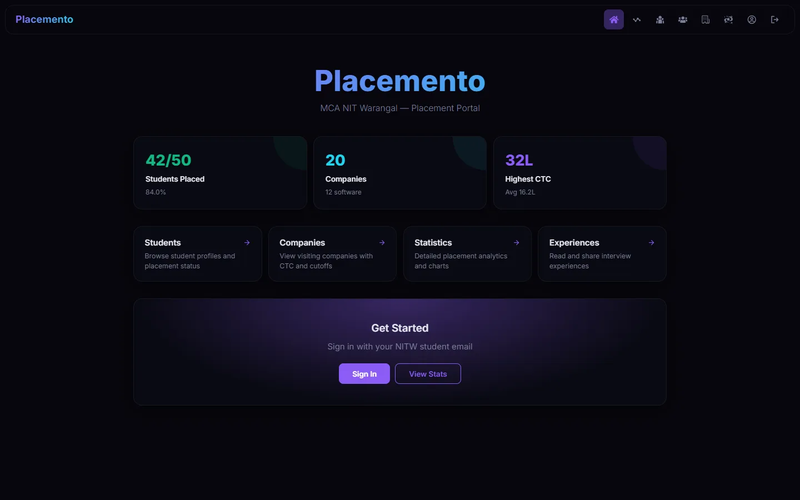
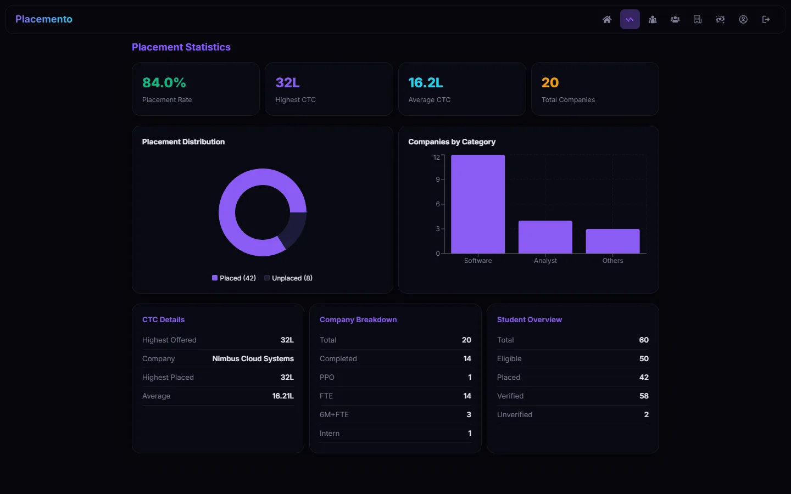
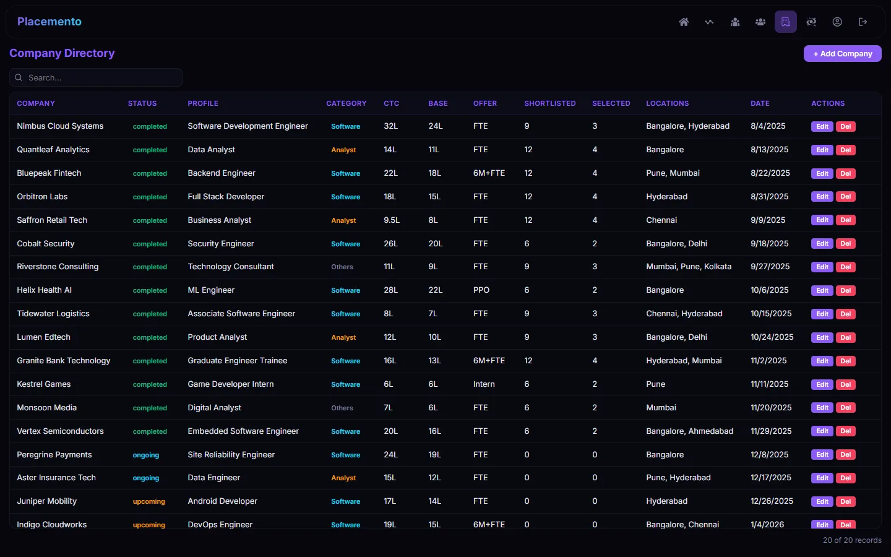
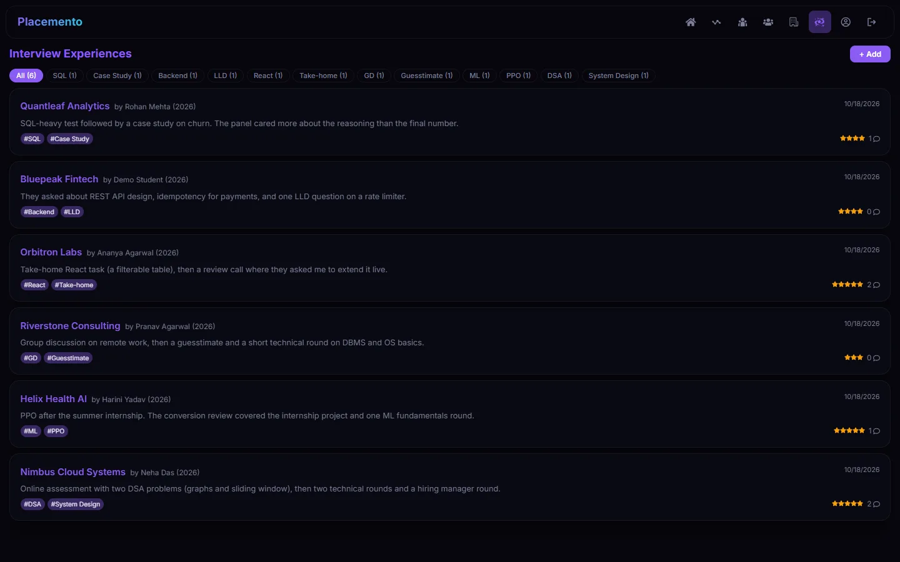
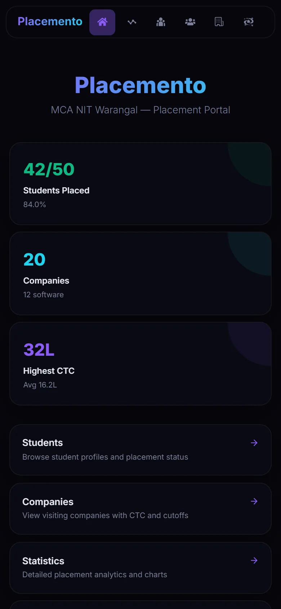
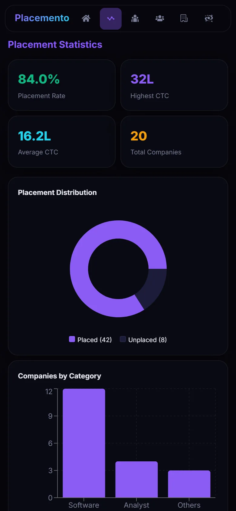
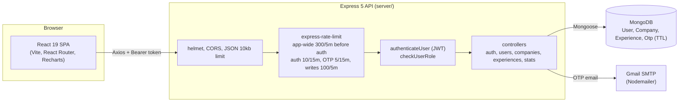
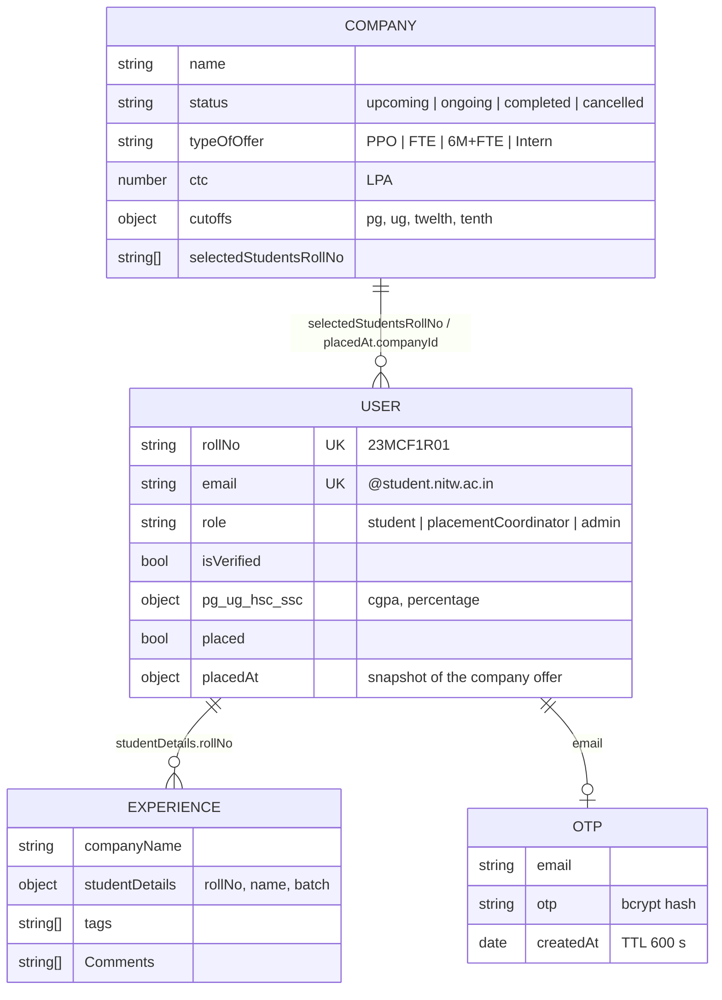

# Placemento

[](https://github.com/MCA-NITW/placemento/actions/workflows/ci.yml)
[](https://github.com/MCA-NITW/placemento/actions/workflows/codeql.yml)
[](https://www.gnu.org/licenses/gpl-3.0)
[](https://react.dev/)
[](https://www.typescriptlang.org/)
[](https://nodejs.org/)
[](https://mongoosejs.com/)

**Placemento** is the placement portal for the MCA batch at NIT Warangal. It replaces the shared spreadsheet a placement cell usually runs on:
students keep their academic profile in one place, placement coordinators record each visiting company with its CTC, cutoffs and selected roll
numbers, and everyone sees live placement statistics and interview experiences from seniors.

It is a TypeScript pnpm monorepo: a React 19 + Vite single-page app talking to an Express 5 REST API backed by MongoDB.

## Try it in one command

```bash
pnpm install
pnpm demo
```

`pnpm demo` starts the API on an in-memory MongoDB replica set loaded with a fake batch (60 students, 20 companies, 6 interview experiences) and
serves the client on http://localhost:3000. No Atlas account, Docker, Gmail or `.env` needed; the data is thrown away when you stop it. Sign in with
any of these, password `Demo@1234`:

| Role                   | Email (type the part before `@` on the sign-in form) |
| ---------------------- | ---------------------------------------------------- |
| `admin`                | `admin.demo@student.nitw.ac.in`                      |
| `placementCoordinator` | `coordinator.demo@student.nitw.ac.in`                |
| `student`              | `student.demo@student.nitw.ac.in`                    |

## Screenshots

Captured from `pnpm demo`, so every name, company and number below is fake.

| Home                                          | Statistics                                                 |
| --------------------------------------------- | ---------------------------------------------------------- |
|            |                  |
| **Companies**                                 | **Interview experiences**                                  |
|  |  |

On a phone (390 px wide):

<p>
  
  
</p>

## Features

- **Student profiles** - PG, UG, HSC and SSC scores, backlogs and academic gaps, with server-side range validation
- **Company tracking** - status, offer type, profile category, CTC and base breakup, bond, cutoffs, locations and the selected roll numbers
- **Placement assignment** - marking a student placed updates the student and both the old and new company in one MongoDB transaction
- **Live statistics** - placed vs total, highest and average CTC, company and location breakdowns, charted with Recharts
- **Interview experiences** - students post experiences with tags, rating, difficulty, process and tips; others comment
- **Auth** - signup restricted to `@student.nitw.ac.in` emails, admin verification before first sign-in, JWT sessions, emailed OTP for password reset
- **Role-based access** - `student`, `placementCoordinator` and `admin`, enforced per route on the server; students can only edit their own record and
  never see other students' academic scores
- **Searchable, sortable tables** - a small in-house `DataTable` component with nested-key search
- **Responsive UI** - fluid grids and horizontally scrolling tables and navbar on phones
- **Team page** - credits the people who built and maintain the portal

## Architecture



Request path for a protected write such as `PUT /users/company/:id`: JWT verified and the user reloaded from the database (so a deleted or unverified
account is rejected immediately), role checked, rate limit applied, then the controller runs a transaction that pulls the roll number from the
previous company, adds it to the new one and rewrites the student's `placedAt` snapshot.

The API is mounted at both `/api/v1/*` and the legacy root paths (`/auth`, `/users`, `/companies`, `/experiences`, `/stats`); `/health` reports uptime
and database state.

### Data model



Relations are by value (roll number, company id string, email), not Mongoose refs. That is why a placement change has to update both sides inside one
transaction.

### Repository layout

```
placemento/
├── client/                 # React 19 + Vite SPA
│   ├── src/api/            # Axios instance and one module per resource
│   ├── src/components/     # NavBar, DataTable, AuthForm, CompanyForm, Modal, ...
│   ├── src/pages/          # Home, Stats, Students, Companies, Experience, Profile, Teams, Auth
│   └── tests/              # Vitest + Testing Library (jsdom)
├── server/                 # Express 5 API
│   ├── src/controllers/    # Route handlers
│   ├── src/middleware/     # JWT auth and role checks
│   ├── src/models/         # Mongoose schemas (source of truth for data shapes)
│   ├── src/routes/         # Route tables
│   ├── src/seed/           # Demo dataset, `pnpm seed` and `pnpm demo`
│   ├── src/utils/          # Rate limiters, Winston logger, signup validation
│   └── tests/              # Vitest + Supertest against mongodb-memory-server
├── docs/screenshots/       # README screenshots, captured from `pnpm demo`
├── .github/workflows/      # CI, CodeQL, tag-driven releases
├── docker-compose.yml      # Local MongoDB single-node replica set
└── pnpm-workspace.yaml     # Workspace, build allowlist and security overrides
```

## Tech decisions

| Choice                             | Why                                                                                                                         |
| ---------------------------------- | --------------------------------------------------------------------------------------------------------------------------- |
| pnpm workspace                     | One lockfile and one install for client and server; `overrides` pin patched transitive dependencies                         |
| MongoDB + Mongoose                 | Company and student records are nested documents (CTC breakup, cutoffs, academic blocks) that change often                  |
| Transactions for placement updates | A student and two company documents must change together or not at all                                                      |
| JWT re-validated against the DB    | Revoking verification or deleting a user takes effect on the next request, not when the token expires                       |
| Hashed, TTL-indexed OTPs           | OTPs are bcrypt-hashed at rest and MongoDB deletes them after 10 minutes                                                    |
| String coercion on auth inputs     | Blocks NoSQL operator injection such as `{ "email": { "$gt": "" } }`                                                        |
| One answer for unknown email       | Login and password reset reply the same way whether or not an email is registered, so they cannot be used to list the batch |
| Rate limit before auth             | The app-wide limiter runs before `authenticateUser`, so even rejected tokens cannot hammer the per-request DB lookup        |
| mongodb-memory-server in tests     | Server tests run against a real replica set (needed for transactions) with no external database                             |
| Same engine for `pnpm demo`        | The demo reuses the test setup's in-memory replica set, so a reviewer gets the real API with zero setup                     |

## Quick start

### Prerequisites

- Node.js 22 or 24
- pnpm 12 (`corepack enable` picks up the version pinned in `package.json`)
- MongoDB (local, Docker, or a MongoDB Atlas connection string). Not needed for `pnpm demo`.

### Install and run

```bash
git clone https://github.com/MCA-NITW/placemento.git
cd placemento
pnpm install
```

Create `server/.env` (see `server/.env.example`). Variable names:

| Variable                     | Required | Purpose                                                                  |
| ---------------------------- | -------- | ------------------------------------------------------------------------ |
| `DB_CONNECTION_STRING`       | yes      | Primary MongoDB URI (e.g. Atlas)                                         |
| `JWT_SECRET`                 | yes      | Signs session tokens                                                     |
| `JWT_SALT_ROUNDS`            | yes      | bcrypt cost for password hashes                                          |
| `LOCAL_DB_CONNECTION_STRING` | no       | Fallback URI if the primary is unreachable                               |
| `EMAIL_ID`, `EMAIL_PASSWORD` | no       | Gmail account used to send OTP emails                                    |
| `PORT`                       | no       | API port, default `5000`                                                 |
| `CORS_ORIGIN`                | no       | Allowed browser origin, default `http://localhost:3000`                  |
| `LOG_LEVEL`                  | no       | Winston log level                                                        |
| `TRUST_PROXY`                | no       | Proxy hop count (e.g. `1` on Render) so rate limits key on the client IP |

The client reads `VITE_API_BASE_URL` (default `http://localhost:5000`).

```bash
pnpm dev
```

This starts the API with `tsx watch` on port 5000 and the Vite dev server on http://localhost:3000.

### Local MongoDB with Docker and seed data

Transactions need a replica set, so `docker-compose.yml` runs MongoDB as a single-node replica set and initiates it on first boot:

```bash
docker compose up -d
pnpm seed
pnpm dev
```

with `DB_CONNECTION_STRING=mongodb://localhost:27017/placemento?replicaSet=rs0&directConnection=true` in `server/.env`. `pnpm seed` loads the same
demo dataset and logins as `pnpm demo`. It refuses to run against a database that already has users; `pnpm seed --reset` replaces everything, so never
point it at a real batch.

## Scripts

| Command                      | Description                                                                 |
| ---------------------------- | --------------------------------------------------------------------------- |
| `pnpm demo`                  | Demo API on in-memory MongoDB with seeded data, plus the client             |
| `pnpm seed`                  | Load the demo dataset into `DB_CONNECTION_STRING` (`--reset` to wipe first) |
| `pnpm dev`                   | API (tsx watch) and client (Vite) together                                  |
| `pnpm start`                 | Built API (`node dist/index.js`) and Vite client                            |
| `pnpm build`                 | Client production build to `client/build`                                   |
| `pnpm --filter server build` | Compile the API to `server/dist`                                            |
| `pnpm test`                  | Server tests, then client tests (Vitest)                                    |
| `pnpm format`                | Prettier over the whole repo                                                |

## Testing and CI

- **Server**: 44 Vitest + Supertest tests covering signup, login, account-enumeration resistance, privilege-escalation attempts, token expiry, company
  CRUD permissions, experience ownership and demo-data consistency (every demo login works, every placed student meets the company cutoff and appears
  in its selection list), run against an in-memory MongoDB replica set
- **Client**: 27 Vitest + Testing Library tests for components and form validation
- **CI** (`.github/workflows/ci.yml`): build, both test suites, Prettier check and a security scan on every push and PR
- **CodeQL** on push, on PRs and weekly; **Renovate** keeps dependencies current
- **Releases**: pushing a `v*.*.*` tag runs `release.yml`, which tests, builds and attaches a tarball and zip to a GitHub Release

## Contributing

See [CONTRIBUTING.md](CONTRIBUTING.md). In short: branch from `main`, run `pnpm test` and `pnpm format`, and open a pull request with a clear
description. Security issues go through [SECURITY.md](SECURITY.md).

## License

This project is licensed under the **GPL-3.0 License**. See the [LICENSE](LICENSE) file for details.

## Contact & Support

- **Project Repository**: [MCA-NITW/placemento](https://github.com/MCA-NITW/placemento)
- **Issues & Bug Reports**: [GitHub Issues](https://github.com/MCA-NITW/placemento/issues)
- **Institution**: [NIT Warangal - MCA Department](https://www.nitw.ac.in/department/mca)

## Development Team

- **[Sagar Gupta](https://github.com/Sagargupta16)** - Lead Developer
- **[Sachin Gupta](https://github.com/sachin-gupta99)** - Full Stack Developer

## Acknowledgments

- **NIT Warangal College** - For providing the academic environment and support
- **MCA Department** - For guidance and project requirements
- **Open Source Community** - For the amazing tools and libraries that made this project possible

## Useful Resources

- [React Documentation](https://react.dev/)
- [Vite Documentation](https://vite.dev/)
- [Express Documentation](https://expressjs.com/)
- [Mongoose Documentation](https://mongoosejs.com/docs/)
- [MongoDB Atlas](https://www.mongodb.com/atlas)

---

### Made with ❤️ by MCA Students of NIT Warangal
